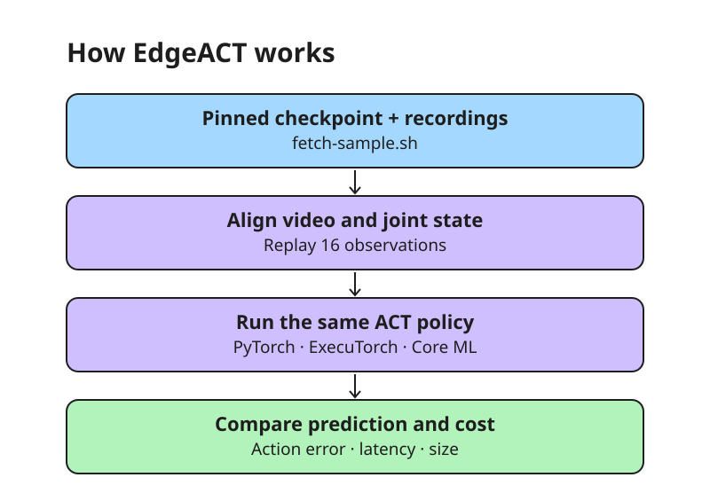

# EdgeACT benchmark pipeline

Open the [editable Excalidraw scene](pipeline.excalidraw) in Excalidraw.

- `fetch-sample.sh` fetches pinned ACT weights, preprocessing settings, and the corresponding LeRobot dataset shards.
- `benchmark.py` aligns camera frames with joint positions, applies the checkpoint's processors, and creates a PyTorch eager reference. The same fixed-shape inputs feed the ExecuTorch and Core ML exports.
- Each runtime produces a chunk of future actions. The harness times inference and compares the complete unnormalized action chunk against eager. The experiment uses recorded observations. Physical task success requires a live or simulated rollout.
- `results/` holds the full latency samples, action errors, artifact sizes, and power settings. The automated parity test uses a tiny deterministic two-camera fixture.

[Read the slowdown investigation](investigation.md).
