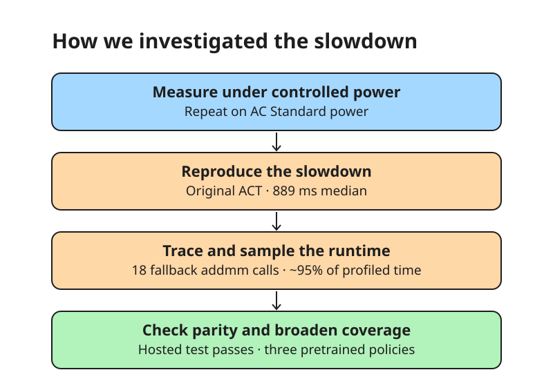

# Investigating the slowdown

Open the [editable Excalidraw scene](investigation.excalidraw) in Excalidraw.

The first run used Low Power Mode. Repeating on AC Standard power still left the original ExecuTorch model at 889 ms median versus 75 ms for eager. The graph contained 20 XNNPACK partitions. ETDump and native stack sampling identified the dominant cost in the fallback matrix multiplies. The 18 `addmm` calls used about 904 ms of the 953 ms profiled inference. [Profile data](../results/executorch-profile-ac.json)

The first hosted FP16 parity check exceeded its initial tolerance. The passing retry pins CPU-only Core ML for the fixture and documents a 0.01 absolute tolerance in normalized action space. The benchmark enables all Core ML compute units. [Passing parity check](https://github.com/j-ctang/edge-act/actions/runs/44496154485)
