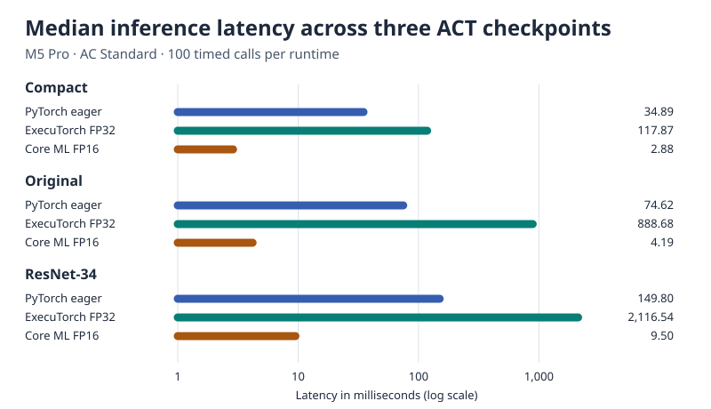

# EdgeACT benchmark results

Core ML had the lowest median latency across all three checkpoints. The compact ACT checkpoint used a narrower transformer and smaller camera frames. The checkpoints also differ in camera count and action-chunk length, so the comparison measures each complete deployment.

| Checkpoint | Runtime | p50 (ms) | p99 (ms) | Artifact (MB) | Action MSE | Max action error |
| --- | --- | ---: | ---: | ---: | ---: | ---: |
| Compact | PyTorch eager | 34.89 | 36.97 | 62.29 | 0 | 0 |
| Compact | ExecuTorch FP32 | 117.87 | 121.00 | 62.57 | 1.92e-13 | 4.35e-06 |
| Compact | Core ML FP16 | 2.88 | 3.27 | 30.74 | 3.38e-07 | 0.00607 |
| Original | PyTorch eager | 74.62 | 115.50 | 206.70 | 0 | 0 |
| Original | ExecuTorch FP32 | 888.68 | 1,024.78 | 137.55 | 1.52e-10 | 0.000132 |
| Original | Core ML FP16 | 4.19 | 5.23 | 66.41 | 0.00022 | 0.193 |
| ResNet-34 | PyTorch eager | 149.80 | 155.74 | 246.97 | 0 | 0 |
| ResNet-34 | ExecuTorch FP32 | 2,116.54 | 2,388.23 | 178.07 | 1.11e-10 | 6.87e-05 |
| ResNet-34 | Core ML FP16 | 9.50 | 13.01 | 86.83 | 0.000108 | 0.0575 |

## Reading the results

Action error compares each export with its own checkpoint's PyTorch eager reference on 16 recorded observations. Core ML used all available compute units. ExecuTorch had the smallest action error among the exports on all three checkpoints. The [slowdown investigation](investigation.md) explains where the original ExecuTorch run spent its time.

[Compact raw data](../results/benchmark-compact-ac.json) · [Original raw data](../results/benchmark-ac.json) · [ResNet-34 raw data](../results/benchmark-resnet34-ac.json)
